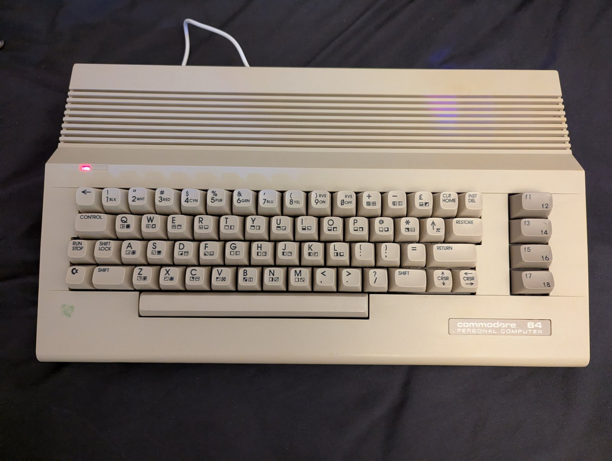
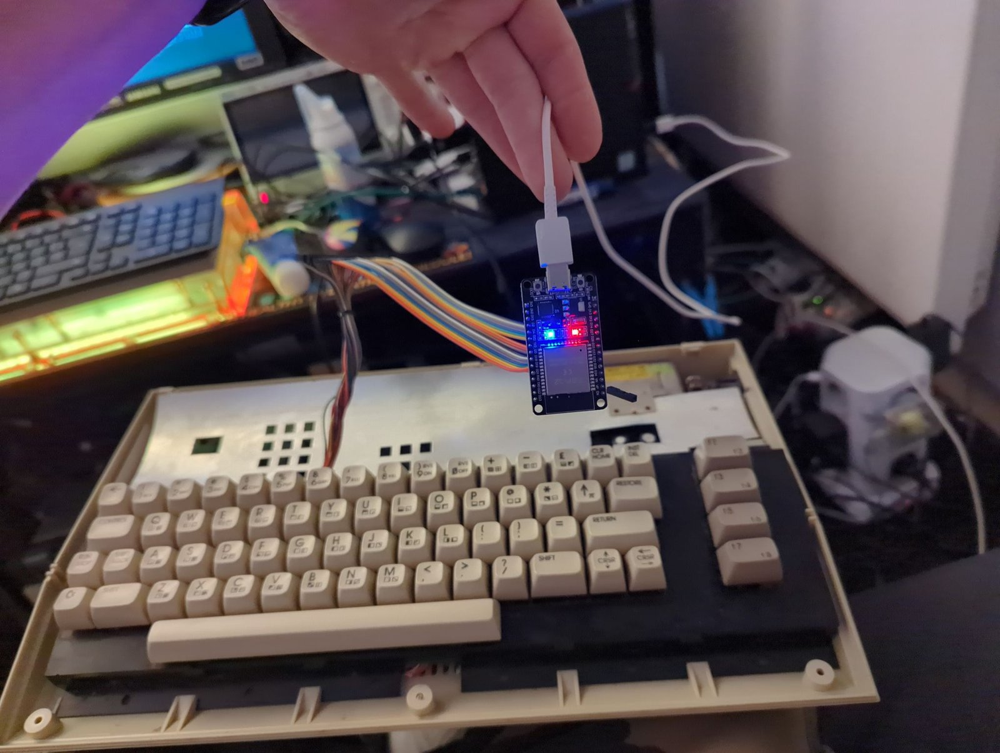

# C64 Bluetooth Keyboard

**Transformer un Commodore 64C dont la carte mère est morte en clavier Bluetooth pour émulateur (VICE).**

Un ESP32 DevKit V1 se branche directement sur le connecteur 20 broches du clavier C64. Il scanne la matrice 8×8 et la touche RESTORE, puis se présente comme un clavier Bluetooth Low Energy (HID) standard. Ça fonctionne sous macOS, Linux et Windows, sans pilote. La LED « POWER » du boîtier sert de voyant de connexion.





## Matériel

- un clavier de C64 / C64C (le connecteur 20 broches d'origine)
- un ESP32 DevKit V1 (30 broches, ESP32 « classique » avec Bluetooth)
- 19 fils Dupont femelle, plus une résistance de 220 Ω pour la LED
- un câble USB pour l'alimentation (chargeur ou batterie)

L'ESP32 DevKit V1 ne peut pas faire de clavier **USB** : son port USB passe par un convertisseur série. Il faudrait un ESP32-S2/S3 ou une Pro Micro pour ça. Ici, c'est donc du Bluetooth.

## Câblage

Le connecteur clavier du C64 a 20 broches, numérotées de 1 à 20. La broche 2 est un détrompeur.

| Pin C64 | Signal  | ESP32 | | Pin C64 | Signal | ESP32 |
|--------:|---------|-------|-|--------:|--------|-------|
| 1  | GND     | GND  | | 11 | PB1 | D22 |
| 2  | (clé)   | —    | | 12 | PB0 | D23 |
| 3  | RESTORE | D5   | | 13 | PA0 | D13 |
| 4  | +5V     | **non connecté** | | 14 | PA6 | D32 |
| 5  | PB3     | D19  | | 15 | PA5 | D33 |
| 6  | PB6     | RX2 (GPIO16) | | 16 | PA4 | D25 |
| 7  | PB5     | TX2 (GPIO17) | | 17 | PA3 | D26 |
| 8  | PB4     | D18  | | 18 | PA2 | D27 |
| 9  | PB7     | D4   | | 19 | PA1 | D14 |
| 10 | PB2     | D21  | | 20 | PA7 | D15 |

**LED du boîtier :** `D2 → 220 Ω → anode (+)`, puis `cathode (−) → GND`.

| LED | Signification |
|-----|---------------|
| clignote | en attente de connexion |
| fixe | connecté |

La LED bleue de la carte ESP32 fait la même chose.

Notes :
- Tout fonctionne en 3,3 V. Il n'y a aucune résistance à ajouter sur la matrice, les pull-up internes de l'ESP32 suffisent.
- Le câblage tombe bien : tout le côté gauche de la carte sert aux lignes PA, et le côté droit aux lignes PB, à RESTORE et à la LED.
- Les broches qui gênent le démarrage ou le flashage sont évitées : GPIO 0, 1, 3, 6‑11 et 12. Les GPIO 34‑39 sont aussi laissées de côté, car elles n'ont pas de pull-up interne.

## Firmware

Le firmware utilise uniquement la librairie BLE incluse dans le cœur **esp32 3.x** d'Arduino, sans aucune dépendance externe.

```sh
arduino-cli core install esp32:esp32
arduino-cli compile --fqbn esp32:esp32:esp32 c64_ble_keyboard
arduino-cli upload  --fqbn esp32:esp32:esp32 -p /dev/ttyUSB0 c64_ble_keyboard
```

Dans l'IDE Arduino, ouvre `c64_ble_keyboard/c64_ble_keyboard.ino` avec la carte « ESP32 Dev Module ».

Le clavier apparaît sous le nom **« C64 Keyboard »**. L'appairage se fait sans code PIN.

Sur le port série (115200 bauds), chaque touche détectée s'affiche (`PA3 PB4 appui`). C'est pratique pour vérifier le câblage.

### Ce qui le rend fiable

- **Anti-rebond immédiat :** une touche est prise en compte dès le premier contact, puis ignorée pendant 8 ms pour absorber les rebonds.
- **File d'attente des rapports :** chaque appui et chaque relâchement est envoyé séparément, à au moins 15 ms d'écart. Une frappe très brève n'est donc jamais « avalée », un problème classique des claviers BLE ESP32 sous macOS.
- **Renvoi automatique :** si la pile Bluetooth refuse un envoi, il est renvoyé. Aucune touche ne reste « collée ».
- **Intervalle de connexion court :** le clavier demande 11,25 à 30 ms, des valeurs conformes aux règles d'Apple et acceptées par Linux et Windows.

## VICE : la keymap

VICE traduit les touches à partir des **symboles** produits par la disposition clavier de l'ordinateur. Il faut donc une keymap qui corresponde à ta disposition :

| Système / disposition | Fichier |
|---|---|
| macOS, AZERTY français | `vice/c64_ble_mac_fr.vkm` |
| Linux, AZERTY fr (latin9) | `vice/c64_ble_linux_fr.vkm` |
| Windows, AZERTY français | `vice/c64_ble_linux_fr.vkm` (mêmes symboles) |

Dans VICE : *Préférences → Input devices → Keyboard → Keymap : **Positional (user)*** puis choisis le fichier.

Équivalent dans `vicerc` :

```ini
[C64SC]
KeymapIndex=3
KeymapUserPosFile="/chemin/vers/c64_ble_linux_fr.vkm"
```

Le clavier du PC continue de fonctionner normalement à côté.

| Touche C64 | Touche envoyée |
|---|---|
| RUN/STOP | Échap |
| RESTORE | Page ↑ |
| CTRL | Tab |
| C= | Ctrl gauche |
| £ / CLR HOME | Fin / Origine |
| / | Page ↓ |

### Une autre disposition (QWERTY, belge…)

Ajoute-la dans `vice/gen_vkm.py`, dans le dictionnaire `LAYOUTS`. Il suffit d'indiquer quel symbole produit chaque touche, puis de régénérer les keymaps :

```sh
cd vice
python3 gen_vkm.py /chemin/vers/vice/C64/gtk3_pos.vkm
```

Les pull requests avec de nouvelles dispositions sont bienvenues.

## Crédits

- Inspiré de [omiq/c64-keyboard-USB](https://github.com/omiq/c64-keyboard-USB), d'après le travail de DJ Sures.
- Matrice clavier : [sta.c64.org](http://sta.c64.org/cbm64kbdlay.html) et [C64-Wiki](https://www.c64-wiki.com/wiki/Keyboard).

Article complet sur [labbej.eu](https://labbej.eu/blog).

## Licence

MIT, voir [LICENSE](LICENSE).
